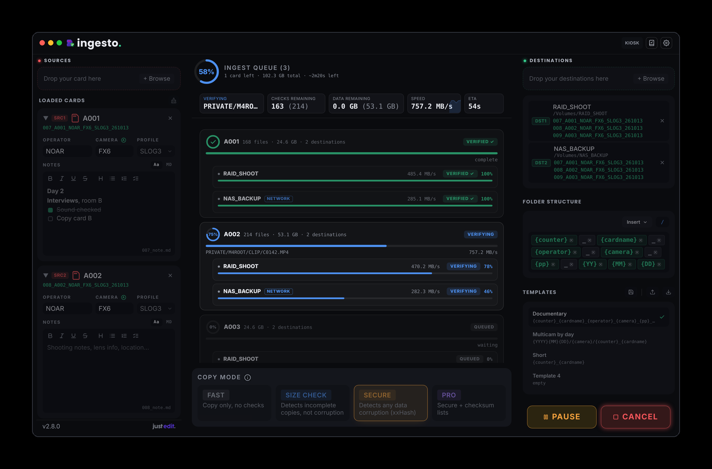
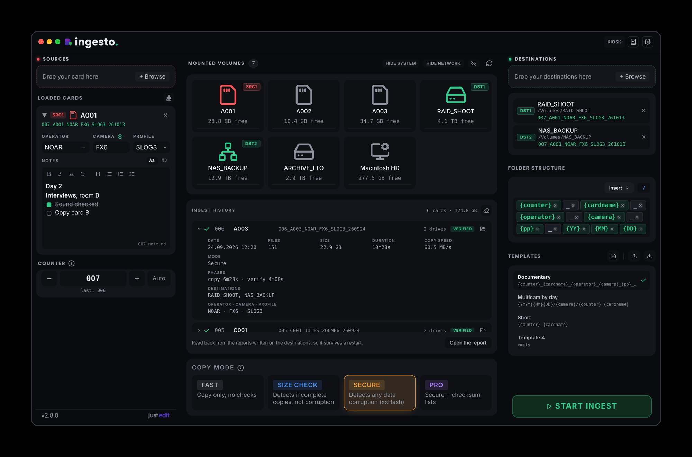
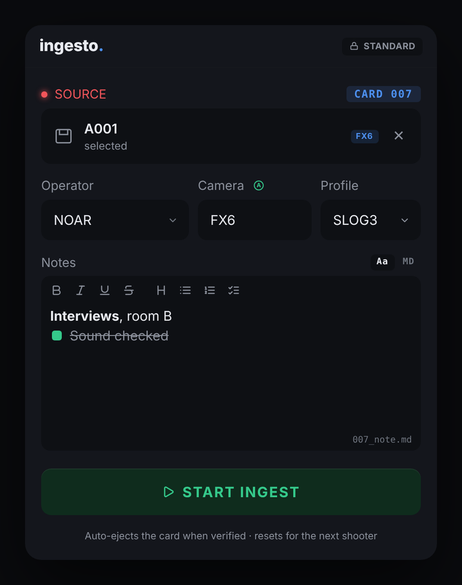
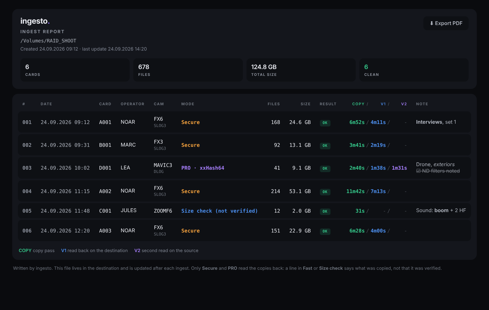

# ingesto
### 专业摄像机素材上载工具
Develop by just edit; Translate by wibi8bo.

原项目地址：[https://github.com/noar-justedit/ingesto](https://github.com/noar-justedit/ingesto)
本仓库：[https://github.com/wibi8bo/ingesto](https://github.com/wibi8bo/ingesto)

中文界面自 2.12.0 起随上游内置（词典 `src/renderer/lang/zh-CN.js`），可在设置中切换；本仓库维护中文文档和中文使用说明。

面向视频与音频专业人员（DIT 数字影像技师、摄影师、剪辑师）的免费开源素材上载（ingest）工具——可将素材从存储卡和硬盘复制到任意多个目标位置，每个文件都会被回读并校验；支持摄像机自动识别、校验和清单、MHL 与 ASC MHL 清单、上载报告、手机推送通知，以及适用于现场使用的 Kiosk（自助终端）模式。

本软件基于 **GNU 通用公共许可证 v3.0** 授权（见 [`LICENSE`](./LICENSE)）。
你可以自由地使用、学习、修改和再分发本软件，但任何分发的修改版本必须保持相同的许可证，并且公开其源代码。完整条款见许可证文件。

macOS · Windows · Linux。

---

## 60 秒看它如何工作

[](https://youtu.be/_rSURz65jlo)

---

## 功能介绍

- **一张卡同时复制到多个目标位置**，随后回读每个目标位置并逐一比对指纹——所有目标位置是**同时**完成校验的，而非一个接一个。
- **全程清楚显示每张卡的位置**：每张卡一个区块，每个目标位置一行，各自显示独立的进度和实时吞吐量。
- **发现问题时拒绝开始**，而不是在复制过程中逐个文件报错——例如已加载后被拔出的硬盘、两张会落入同一文件夹的卡、一张空白的卡。
- **完整记录所做的操作**：HTML/CSV/JSON 报告、校验和清单、MHL 与 ASC MHL v2.0 清单，以及每张卡一条推送通知。
- **绝不说无法证实的话。**"已验证（verified）"一词只用于每个文件都从目标位置回读并比对过的任务（SECURE、PRO 模式）。FAST 模式明确标注*未验证*；SIZE CHECK 标注*仅检查大小*——这一区分出现在所有界面上：摘要、传输列表、报告、手机通知、Kiosk 模式。报告过错误的卡、被中止的批次、什么都没复制的任务：永远不会显示为成功。
- **在所有平台上都用存储卡自己的名称称呼它。** 在 Windows 上，卷列表显示 `LUMIX (D:)`，因此插在两个读卡器里的两张相同的卡也能被区分开；而 `{cardname}`、上载报告和手机通知使用的是纯卷标——`LUMIX`。
- **说你的语言。** 英语、法语和简体中文，在设置中选择（首次启动跟随系统语言）。界面、报告和手机通知都会跟随切换；卡、硬盘和文件夹名永不翻译。
- **绝不触碰源卡。** ingesto 从不在它所复制的卡上删除、重命名或覆盖任何文件。卡正在上载期间会被锁定：任何会写入该卡的删除、重命名或写入操作都会被拒绝，包括通过指向该卡的符号链接进行的操作；一旦拒绝，操作即停止，而不会另寻路径绕过。唯一会向卡写入内容的功能是默认关闭的**卡片追踪（Card Tracking）**，而且它只写入自己的日志文件 `.ingesto.json`。
- **绝不写入一个已存在的卡片文件夹。** 无论界面上勾选了什么，只要目标文件夹中存在非自身（中断任务残留）内容，引擎都会拒绝写入。这是防止素材被覆盖的最后一道防线——没有 `{counter}` 的模板、两张都叫 "NO NAME" 的卡、作为符号链接的文件夹、计数器读错、两台电脑共用一块硬盘：全部拒绝，什么都不写。

---

## 截图



| 主窗口 | Kiosk 模式 | 报告 |
|---|---|---|
|  |  |  |

---

## 快速安装（无需编程基础）

**最简单的方式：** 从 [Releases 页面](https://github.com/wibi8bo/ingesto/releases/latest)下载现成的安装包。
自 v2.5.5 起，macOS 应用已**通过 Apple 签名和公证**——正常双击即可打开，没有安全警告，不需要任何变通操作。

**系统要求（自 v2.8.0 起）：** Apple 芯片机型需 macOS 13 Ventura 或更高版本；Windows 10 或 11（64 位）；Linux x64。2.7 版本仍可在 macOS 12 Monterey 上运行。

更想自己构建？请按下面的步骤操作。

### 第 1 步——安装 Node.js
1. 打开浏览器，访问 **https://nodejs.org**
2. 点击绿色的 **"LTS"** 按钮（推荐版本）
3. 下载并安装 `.pkg` 文件
4. 按安装程序提示操作（一路点击"继续"直到完成）

### 第 2 步——下载 ingesto
克隆或下载本仓库（点击 `Code` → `Download ZIP`，或执行
`git clone https://github.com/wibi8bo/ingesto.git`），然后解压到你喜欢的位置（例如桌面或 `~/Documents`）。

### 第 3 步——构建应用
1. 打开 `ingesto/scripts/` 文件夹
2. **双击 `build_mac.command`**
   - 如果 macOS 弹出确认提示，点击 **"打开"**
   - 如果双击后文件是在文本编辑器中打开而不是运行，说明下载过程丢失了可执行权限。在 `ingesto` 文件夹中打开终端，执行一次 `chmod +x scripts/*.command scripts/*.sh`；或者直接用 `bash scripts/build-mac.sh` 运行构建。
   - 终端窗口会打开并自动构建所有内容
   - 首次运行需要 2-3 分钟（下载依赖）
3. 完成后，脚本会询问是否打开 `dist/` 文件夹

Windows 版本请使用 `scripts/build_win_from_mac.command`（在 Mac 上交叉构建）——生成的安装包未经签名，因此首次启动时 Windows 会显示 SmartScreen 警告（属正常现象；点击"更多信息" → "仍要运行"）。
Linux 版本请在 Linux 机器上运行 `bash scripts/build-linux.sh`。

为一个平台构建不会清除另一个平台的产物：你可以先后构建 Mac 应用和 Windows 安装包，两者都会保留。

### 第 4 步——安装应用
1. 在 `dist/` 文件夹中打开 `.dmg` 文件
2. 将 **ingesto** 拖入 **应用程序** 文件夹
3. 自己构建的版本是未经签名的（签名需要 Apple 开发者证书）。如果 macOS 在首次启动时拦截它，右键点击应用 → **"打开"**。Releases 页面上的安装包没有这个问题——它们已经过签名和公证。

---

## 不构建即可试用（开发模式）

如果只想在构建之前先试用：
1. 安装 Node.js（见第 1 步）
2. 双击 `scripts/dev.sh`

---

## 使用应用

### 界面

三栏布局：你复制什么、正在发生什么、复制到哪里。

**源（Sources，左栏）**

- 每张已加载的卡都有自己的 **操作员（Operator）**、**摄像机（Camera）**、**Profile（图像配置文件）**和**备注（Notes）**，并显示它将创建的文件夹。操作员、摄像机和 Profile 共用一行。
- **Profile** 会打开一个常用图像配置文件菜单，按厂商分组（索尼、佳能、松下、富士、ARRI、RED、尼康、Blackmagic、大疆、手机……）。每个条目显示 `{pp}` 将写入的内容。其他任何配置文件都可以在菜单底部自行输入。
- **操作员（Operator）** 会记住 ingesto 打开以来使用过的名字：箭头可以列出它们，输入首字母可以缩小列表范围。上载开始时，名字会加入列表。该列表不会保存：下次启动时又是空的。
- **备注（Notes）** 使用 markdown 编写。可以用格式按钮输入（粗体、斜体、下划线、删除线、标题、列表、勾选清单），也可以切换到 **MD** 直接输入 markdown 源码。备注会以 `001_note.md` 为名保存在素材旁边（2.7 及更早版本写入的是 `001_note.txt`；两种文件都能被校验功能识别）。下划线没有 markdown 形式，会写成 `<u>文本</u>`。
- 操作员、摄像机和图像配置文件会**在一张张卡之间保留**：新加载的卡以上次输入的值开始，直到你修改它们。备注只描述一张卡，每次上载后清空。标题旁边的**扫帚**按钮可一键清空全部四个字段。
- 标签旁边的绿色小 **(A)** 表示该值是 ingesto 从卡上读取的；灰色 **(M)** 表示它是手动输入的（在本张卡上输入或从上一张卡沿用）。
- **计数器（counter）**固定在该栏底部。

**已挂载卷与上载历史（中栏）**

- **已挂载卷**：SD 卡、硬盘和网络共享，每个都带有类型图标（存储卡、系统盘、网络、外置），被指定后会显示 SRC/DST 徽标。列表默认显示两行，之后在卡片内部滚动。
- **上载历史**：当前已加载的各目标位置上曾上载过的每张卡，一张卡一行，显示它去了哪些硬盘以及结果。它是从这些硬盘上写入的报告中回读出来的，而不是保存在内存中：重启后依然存在，一块从其他机器接回来的硬盘也会带着它的历史记录到来。某一行的文件夹按钮可在访达（Finder）或资源管理器（Explorer）中显示该卡的文件夹。
- **点击某一行**可打开详情：日期与时间、文件数、大小、每个阶段的耗时、复制速度、复制模式、每个目标位置、操作员、摄像机、图像配置文件和备注。
- 其标题栏中的**橡皮擦**只清空 ingesto 内的列表，不影响其他任何东西：硬盘上的报告绝不会被触碰。列表在重启后保持清空状态，**重新显示（Show it again）**可把隐藏的行找回来。
- 上载期间，该栏只显示**上载队列**。卷列表和历史会在上载结束后回来。
- **过滤器（Filters）**（栏标题处）：隐藏系统卷和/或网络卷，或手动隐藏某个卷（右键 → 隐藏卷）
- **推出（Eject）**（右键点击卡或硬盘 → **推出**）：无需离开应用即可卸载它。只对可推出的卷提供——绝不适用于系统盘或网络共享——上载运行期间会被拒绝。如果该卷已作为源或目标加载，它会被自动卸载，但仅在推出确实成功之后。
- **↻ 刷新**：刷新卷列表

**目标位置（Destinations，右栏）**

- 每个目标位置列出**它将创建的文件夹**，批次中每张卡一个：硬盘名显示为灰色，新文件夹显示为绿色。
- **文件夹结构**：通过 **Insert（插入）** 菜单构建名称，元素分组为卡信息、日期、你输入的文本（**Insert > Custom text…（插入 > 自定义文本…）**可添加固定文本，如 `DAY1`）以及分隔符。可以拖拽这些标记重新排序，或**双击**该条带手动输入模板。
- **模板（Templates）**：四个命名模板，各自显示将写入的结构。点击一个可加载它，点击一个空模板可把当前结构保存进去。保存、导出和导入是标题栏上的图标。

### 典型工作流
1. **连接**你的源卡 / 源硬盘
2. 将一个源卷**拖入** **源（Sources）**区域（左栏）
   ——或右键点击卷 → **Set as SOURCE（设为源）**
3. 将一块或多块目标硬盘**拖入** **目标位置（Destinations）**区域（右栏）
4. 如有需要，输入**操作员**、**摄像机**、**profile** 和备注——可全局设置，也可逐卡设置
5. 选择一种**复制模式**（见下）
6. 通过 **Insert** 菜单构建**文件夹结构**，或加载一个模板
7. 点击 **START INGEST（开始上载）**

你可以一次加载多张卡。它们会依次上载，每张卡复制到每个目标位置。

### 复制模式

| 模式 | 作用 |
|---|---|
| **FAST** | 仅复制，不做任何检查 |
| **SIZE CHECK** | 检测不完整的复制（仅比较大小——同样大小的损坏文件可以通过；不算已验证） |
| **SECURE** | 检测任何数据损坏——每个文件都从每个目标位置回读并计算指纹（xxHash64） |
| **PRO** | 在 SECURE 基础上增加校验和清单与清单文件、可选的算法（xxHash64 / xxHash128 / MD5），以及可选的**源二次读取**：重新读取卡本身，以发现正在出故障的卡 |

在 SECURE 和 PRO 模式下，回读会真正到达磁盘——ingesto 在校验前会清除操作系统的缓存，因此网络目标位置确实是通过网络读回的，而不是从内存中读出的。

**虚拟卷与 HDE（ARRIRAW、CODEX Platform）。** CODEX Platform（原 Device Manager）可以把 ARRIRAW 以 HDE 形式提供：在 CFast 卡上是一个名字以 `_hde` 结尾的额外卷，在 ALEXA LF / SXT / XT 介质上则是卡自己的卷，沿用原来的名字。无论哪种，文件都是被读取时才生成的。ingesto 通过卷名、或系统标示该卷由程序提供（FUSE）来识别这种卷，并在加载卡时给出提示。随后它会以该卷实际提供的内容、而不是以卡为准来校验副本，并关闭这张卡的二次读卡。CFast 卡启用 HDE 时，其他格式（ProRes）的片段仍留在卡上的另一个卷里。

### 复制过程中——上载队列

复制运行时，中栏显示队列：

- 一个**表示整个队列的圆环**，按所有工作（复制、每个目标位置一次校验，以及 PRO 开启时的源重读）的字节数加权。一张小卡先完成，不再会让进度数字超过一张仍在等待的大卡。
- **每张卡一个区块**，各有自己的圆环；多目标位置时，每个目标位置嵌套一行，带有自己的百分比和吞吐量。落后于其他硬盘的硬盘会清晰可见，而不是被平均值掩盖。
- 一根**用颜色表示当前阶段**的进度条——绿色为复制中，蓝色为校验中，紫色为源二次读取中，红色为出错。
- 标题下方的实时数据：当前文件、剩余文件数与数据量、带吞吐量曲线的速度、剩余时间（按阶段估算）、错误。

**暂停**和**取消**全程可用。其他一切——卡列表、目标位置、文件夹模板、计数器、复制模式——在整个运行期间锁定，而且这些值在你按下开始时就被固定下来，因此之后的任何改动都无法影响已经在进行的复制。

如果有文件失败，**重新复制（re-copy）**按钮只重做这些文件，并在执行时显示同样的队列。

### 校验和与清单

在 PRO 模式下，根据你的设置，ingesto 会在素材旁边写入：

- 一份 TeraCopy 兼容格式的**校验和清单**
  （`.xxh` / `.xxh3` / `.md5`）
- 一份**经典 MHL** 清单
- 一份 **ASC MHL v2.0** 历史记录——一个 `ascmhl` 文件夹，内含一份清单和一个链文件，采用业内 DIT 工具可读取的格式。ingesto 能产生的每种算法都被接受；重新复制失败文件会新增一个"代（generation）"，而不是改写历史。指纹记录为 `verified`（已验证）而非 `original`（原始）：列表中的每个文件都从目标位置回读并比对过。

任何文件都不会计算两次指纹——清单直接使用上载过程中已经算出的值写入。

### 上载开始前的安全检查

- **硬盘已消失。** 你按下开始的那一刻，每张卡和每个目标位置都会被检查。过去，加载后推出某个目标位置再开始，会让整场上载全部报错；现在 ingesto 会拒绝开始，指出是哪块硬盘，并说明尚未复制任何内容。该检查还能捕获：曾是挂载点而现在不再是的文件夹，以及在同一位置挂载了另一张卡的情况。
- **两张卡落入同一文件夹。** 当模板不含 `{counter}` 且两张卡同名时——市面上一半的卡出厂卷标都是 `NO NAME`——过去第二张会覆盖第一张，而两场任务都报告成功。现在 ingesto 会在写入任何内容之前解析全部文件夹名，如果两个名称冲突就拒绝开始，并指出是哪两张卡。
- **卡上没有可复制的内容。** 一个文件都没复制的任务会作为错误报告并说明原因——空文件夹，或文件过滤器排除了所有内容——而不是显示绿色的成功摘要。

### 通知

配置好 ntfy 后，ingesto 会为每张卡发送**一条完整消息**：计数器编号与卡名、操作员、摄像机和图像配置文件、文件数、容量与复制模式、源路径、每个目标位置一行且各自带结果、复制/校验/源重读的耗时、总时长，以及卡片备注。失败的卡会提升为高优先级，并指出是哪个目标位置失败。

### Kiosk 模式

为共享上载工作站提供的锁定全屏视图：一张卡、大号字体、跟随整个队列的圆环，以及上载完成后自动推出——只有在 SECURE 或 PRO 任务后屏幕才显示 *Verified（已验证）*，FAST 或 SIZE CHECK 任务后显示 *do not erase it yet（先不要擦除）*。从卡上检测到的摄像机型号带有与标准窗口中相同的绿色 **(A)**。退出 Kiosk 模式需要 PIN 码，该密码绝不会写入磁盘。

### 日后校验文件夹
**Verify（校验）**按钮（书本图标）可让你通过回读校验和清单或 MHL 清单，重新检查一个已经上载过的文件夹，无需再次复制任何内容。

---

## 文件夹结构与命名

| 变量 | 说明 | 示例 |
|----------|-------------|---------|
| `{counter}` | 自动递增的计数器 | `001`、`002`… |
| `{cardname}` | 源卷名称 | `A001` |
| `{operator}` | 输入的操作员姓名 | `JohnDoe` |
| `{camera}` | 输入/检测到的摄像机型号 | `SonyFX3` |
| `{pp}` | 输入的图像配置文件 | `SLOG3` |
| `{YY}` | 两位年份 | `26` |
| `{YYYY}` | 四位年份 | `2026` |
| `{MM}` | 月份 | `04` |
| `{DD}` | 日期 | `29` |
| `{HH}` | 小时 | `14` |
| `{MIN}` | 分钟 | `35` |

`{cameraman}` 作为 `{operator}` 的旧版别名保留，因此旧模板仍可加载。
`{SS}`（秒）也可用，需手动输入：它不在 Insert 菜单中。

**示例**：`001_A001_JohnDoe_SonyFX3_260429_1435`

`{pp}` 是摄像机设置的图像配置文件。Profile 菜单提供常用项（`SLOG3`、`CLOG3`、`VLOG`、`FLOG2`、`LOGC4`、`HLG`……），也接受你输入的任何其他内容。空格和标点会被去掉，值以大写形式写入，因此 `s-log 3` 和 `SLog3` 都会变成 `SLOG3`：同一场拍摄绝不会因同一个配置文件产生两个文件夹。和其他字段一样它是可选的；留空时不会创建文件夹，也不会留下多余的分隔符。

**文件夹名允许的内容。** 在英语和法语下，文件夹名是纯 ASCII：重音字母变成普通字母（`Hélène` 得到 `Helene`），空格和特殊字符会被移除（卷标为 `NO NAME` 的卡得到 `NONAME`）。只保留 `_` 和 `-` 作为分隔符。完全不含拉丁字母的名字变成 `CARD`。写在素材旁边的拍摄备注保留你输入的全部内容。在中文下，只移除文件系统禁止的字符（`/ \ : * ? " < > |`）。变量本身（`{counter}`、`{cardname}`……）在所有语言下都一样。

### 子文件夹

模板中的 `/` 会开启一个**子文件夹**，因此一场上载可以构建整个目标结构——在复制期间创建，在每个目标位置上完全相同：

```
DAY1/{camera}/{counter}_{operator}_{YY}{MM}{DD}
      →  DAY1/SonyFX3/001_JohnDoe_260429
```

在文件夹结构中，最后一个 `/` 之前的部分显示为**蓝色**（子文件夹），卡自己的文件夹显示为**绿色**。**加粗**的标记是变量，*斜体*的是你输入的、永不改变的文本。Insert 菜单旁边的 `/` 按钮用于添加子文件夹。

以下规则全部在写入任何内容之前强制执行：

- `{counter}` 必须位于卡自己的文件夹中——即最后一个 `/` 之后的部分。它为卡编号，而不是为日期或摄像机编号；计数器对目标位置保持**全局**：每次上载前，INGESTO 会沿模板描述的子文件夹层级遍历目标位置，因此它会跨日期、跨摄像机连续计数，编号中的缺口仍然意味着少了一张卡。
- 输入到卡名、操作员、摄像机或图像配置文件字段中的 `/` 绝不会创建文件夹：只有模板决定结构。
- **由时钟或固定文本构成的子文件夹层级**——`{YYYY}`、`{YYYY}{MM}{DD}`、`DAY1`——无论位于目录树何处，都绝不会被计为一张卡。否则一个 `{YYYY}` 层级会被读作第 2026 张卡，下一次上载就被编号为 2027；`{YY}` 会更隐蔽地产生同样的问题（被当作第 26 张卡）。你自行填写的层级（`{camera}`、`{operator}`、`{pp}`）无法以这种方式识别，保留旧行为：它可能被计数，这只会把计数器向前推，并且在屏幕上可见。
- 解析结果为空的**子文件夹**层级（例如某张卡没有摄像机）不创建文件夹：该卡直接落到上一层。但**最后**一层绝不允许消失——否则卡会落入它与当天其他每张卡共用的文件夹——因此上载会被拒绝。
- 模板末尾的 `/` 不命名任何层级，会被忽略。
- 最多四层，且 `..` 绝不会创建层级，因此上载内容绝不可能被写到你选定的目标位置之外。
- 会落到同一路径的两张卡会被拒绝；会落到另一张卡文件夹*内部*的卡同样会被拒绝。
- 上载报告保留在每个目标位置的根目录，记录每张卡的完整路径，因此报告始终与硬盘上的实际内容一致。ntfy 通知也带有相同的完整路径。

---

## 构建与测试

需要 Node 20.19 或更高版本。

```
npm ci               # 严格安装 package-lock.json 中锁定的版本
npm start            # 从源码运行
npm test             # 引擎测试套件
node scripts/test-regression.js --update   # 有意改变行为后，重新录制回归基准
npm run build        # macOS（Apple 芯片）
npm run build:win    # Windows 安装包，在 Mac 上交叉构建
npm run build:linux  # Linux（在 Linux 上运行）
```

构建脚本使用 `npm ci`，因此带有相同版本号的两次构建带有相同的依赖——包括 `koffi`，即绕过缓存的回读所依赖的原生库。只有在有意更改依赖时才使用 `npm install`，并随之提交更新后的 `package-lock.json`。

---

## 项目结构

```
ingesto/
├── src/
│   ├── main/                  — Electron 主进程
│   │   ├── main.js            — 窗口、菜单、IPC 处理（界面能请求的事情）
│   │   ├── engine.js          — 复制引擎：一张卡到每个目标位置，分阶段执行
│   │   ├── copy-io.js         — 只读一次、写入所有目标位置、临时文件
│   │   ├── source-lock.js     — 阻止任何写入和删除落到卡上的锁
│   │   ├── manifests.js       — 校验和清单、MHL、ASC MHL、拍摄备注
│   │   ├── hashing.js         — xxHash / MD5 指纹
│   │   ├── io-deadline.js     — 每次读卡的超时截止
│   │   ├── mounts.js          — 挂载表：读取时生成的卷（HDE……）
│   │   ├── volumes.js         — 各系统上的硬盘与卡
│   │   ├── counter-scan.js    — 从目标位置回读计数器
│   │   ├── run-control.js     — 暂停与取消，由正在运行的上载共享
│   │   ├── util.js            — 小工具函数
│   │   ├── camera-detect.js   — 根据卡结构检测摄像机品牌/型号
│   │   ├── sentinel.js        — 卡片追踪（.ingesto.json），默认关闭
│   │   ├── nocache.js         — 绕过缓存的回读校验（macOS/Windows/Linux）
│   │   ├── lang.js            — 主进程消息，按所选语言显示
│   │   └── preload.js         — 主进程与渲染进程之间的安全桥接
│   ├── shared/                — 引擎和界面共同遵守的规则
│   │   ├── folder-names.js    — 文件夹模板：变量、子文件夹、安全名称
│   │   ├── modes.js           — 四种复制模式
│   │   └── sources.js         — 判断某个路径是什么来源（HDE）
│   └── renderer/              — 界面
│       ├── index.html         — 窗口的标记结构
│       ├── styles.css         — 样式
│       ├── scripts/           — 界面代码，窗口每个部分一个文件
│       │                        （按 index.html 中列出的顺序加载）
│       ├── i18n.js            — 按所选语言显示界面
│       └── lang/              — 每种语言一个词典（fr.js、zh-CN.js）
├── build-resources/
│   ├── icon.icns / icon.ico   — 编译后的应用图标
│   └── entitlements.mac.plist
├── docs/
│   └── screenshots/            — 本 README 使用的截图
├── scripts/
│   ├── build_mac.command      — 为 Mac 构建应用
│   ├── build_win_from_mac.command — 在 Mac 上构建 Windows 安装包
│   ├── build-linux.sh         — 为 Linux 构建应用
│   ├── dev.sh                 — 以开发模式运行，无需构建
│   ├── test-*.js              — 引擎测试套件（由 `npm test` 运行）
│   ├── test-regression.js     — 用真实上载与录制的基准比较
│   ├── lib/harness.js         — 在 Electron 之外加载真实引擎，供测试使用
│   ├── lib/source.js          — 读取引擎和窗口的源码文本，供测试使用
│   └── fixtures/              — test-regression.js 录制的基准
├── package.json                — 项目配置
├── LICENSE                     — GPL v3 许可证全文
└── README.md                   — 本文件
```

---

## 常见问题

**"无法打开 ingesto，因为 Apple 无法检查它是否包含恶意软件"
/ "……因为无法验证开发者"（macOS，首次启动）**

v2.5.5 之后的 Release 不应该出现这个提示——它们已经过签名和公证，可正常打开。看到此消息意味着你运行的是旧版本，或自己构建的未签名副本。两种解决方法，任选其一即可——只需操作一次：

- **右键方法（最简单）**：在应用程序文件夹中右键（或 Control+点击）ingesto → **打开** → 在弹出的对话框中再次点击**打开**。
- **终端方法**：打开终端（应用程序 → 实用工具 → 终端），粘贴以下命令并回车，然后正常启动 ingesto：
  ```
  xattr -cr /Applications/ingesto.app
  ```

**"build-mac.sh" 无法打开**
→ 终端执行 `chmod +x /path/to/build-mac.sh && /path/to/build-mac.sh`

**卷没有显示出来**
→ 点击 **↻ 刷新**；检查你的卡确实已在访达/资源管理器中挂载

**SECURE 或 PRO 模式下复制很慢**
→ 属正常现象——每个文件都要从每个目标位置回读并计算指纹，而且回读特意绕过了操作系统的缓存，以保证检查是真实的。这就是速度与完整性保证之间的取舍。

**上载被拒绝开始**
→ 阅读提示信息：它会指出问题所在（硬盘已不在、两张卡会落入同一文件夹、卡上没有可复制的内容），并告诉你尚未复制任何内容。

**卡停止响应**
→ ingesto 给每次读卡 60 秒。读卡器卡死、或虚拟卷的服务停滞时，会被报告为无响应，而不是让应用冻结：剩余文件列为未复制，报告会写明是哪些。检查读卡器和线缆，然后重新复制这张卡。

**事后想知道某张卡出了什么问题**
→ 打开硬盘上的 `INGESTO_report.html`，点击那张卡的结果（`2 errors ▸`）：每个文件都会列出出错的步骤和消息。CSV 报告有 `Errors` 列，JSON 报告有 `errs` 列表。

---

## 参与贡献

欢迎在本仓库提交 issue 和 pull request。对于合并哪些内容，维护者保留唯一决定权，但任何真诚的贡献都会被考虑。

### 翻译 ingesto

界面的代码始终是英语；`src/renderer/i18n.js` 用 `src/renderer/lang/` 中的词典把它显示成另一种语言。词典里缺失的文本会原样保留英文，因此翻译可以一点一点补。

新增一种语言：
1. 把 `src/renderer/lang/fr.js` 复制为 `src/renderer/lang/<code>.js`（`de.js`、`zh-CN.js`……），改名 `INGESTO_LANG_FR`，然后翻译其中的值。键是英文原文，保持不变。
2. 在 `src/renderer/index.html` 里法语词典那一行旁边加一行 `<script src="lang/<code>.js"></script>`，并在 `src/renderer/i18n.js` 的 `LANGS` 中加一个条目。
3. 运行 `npm test`：`scripts/test-i18n.js` 会检查每本词典（模式、保留 `{变量}`、报告和通知中不留未翻译的文本）。

永不翻译：模板变量、模式名（FAST、SIZE CHECK、SECURE、PRO）、卡/硬盘/文件名，以及 JSON 报告的字段名。

翻译者：
- 法语：Noar。
- 简体中文（`zh-CN.js`）：[wenjianpai](https://github.com/wenjianpai)，基于 [wibi8bo](https://github.com/wibi8bo) 早先的工作。

## 许可证

本项目基于 **GNU GPL v3.0** 授权。全文见 [`LICENSE`](./LICENSE) 文件。简而言之：你可以自由地使用、学习、修改和再分发本软件；你所分发的任何修改版本必须保持相同的许可证，并公开其源代码。

## 支持

**ingesto** — 本仓库：[github.com/wibi8bo/ingesto](https://github.com/wibi8bo/ingesto)
上游项目：[github.com/noar-justedit/ingesto](https://github.com/noar-justedit/ingesto)

报告 bug 或提出功能需求，请在本仓库提交一个 *issue*：
[github.com/wibi8bo/ingesto/issues](https://github.com/wibi8bo/ingesto/issues)

版权所有 © Just Edit — 2026
